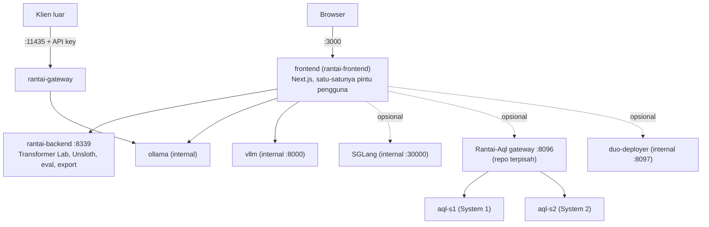

# Memasang RantAI-LLMOps di box baru

Panduan ini untuk memasang LLMOps dari nol sampai siap pakai: antarmuka web, backend training (Transformer Lab +
Unsloth), Ollama, vLLM, SGLang, evaluasi, penyimpanan dataset, Hugging Face, dan halaman Duo dengan Rantai-Aql.
README di akar repo menjelaskan fitur, bukan cara memasang. Untuk pemasangan, ikuti dokumen ini.

Rujukan: [`docker-compose.portainer.yml`](../docker-compose.portainer.yml) adalah sumber kebenaran untuk layanan dan
variabelnya. [`DEPLOY-PORTAINER.md`](DEPLOY-PORTAINER.md) berisi catatan dari box yang sedang berjalan (bagian
"Jebakan" wajib dibaca sebelum mengubah box produksi).

---

## 0. Periksa arsitektur box dulu

```bash
uname -m          # aarch64 atau x86_64
nvidia-smi        # GPU dan versi driver/CUDA
```

| Arsitektur | Image siap pakai di GHCR | Yang perlu dilakukan |
|---|---|---|
| `aarch64` (DGX Spark / GB10, GH200) | **Ya.** `rantai-llmops-fe` dan `rantai-llmops-backend` dibangun untuk `linux/arm64` | Ikuti panduan ini apa adanya |
| `x86_64` (RTX, A100, H100, L40S) | **Tidak.** Workflow `ghcr.yml` hanya membangun `linux/arm64` | Bangun kedua image di box itu (langkah 3B). Jalur ini belum pernah diuji di box produksi |

Catatan GPU: di GB10 kami memakai `vllm/vllm-openai:cu130-nightly` (CUDA 13). Di box lain, pilih tag vLLM yang cocok
dengan versi CUDA driver. `TLAB_FORCE_CUDA13=1` di layanan backend hanya berlaku di GB10 dan diabaikan di box lain.

---

## 1. Komponen dan port



| Layanan (compose) | Wajib | Port host | Fungsi |
|---|---|---|---|
| `frontend` | ya | 3000 | UI dan API aplikasi |
| `rantai-backend` | ya | 8339 | Transformer Lab: job training, eval, mesin berkas. Sidecar GPU (8341) dan export (8342) hanya internal |
| `ollama` | ya | tidak ada (sengaja) | Model chat bawaan dan hasil export GGUF |
| `vllm` | disarankan | tidak ada | Serving safetensors dan adapter LoRA |
| `rantai-gateway` | opsional | 11435 | Pintu berkunci ke Ollama untuk klien luar |
| `duo-deployer` (profil `duo`) | opsional | tidak ada | Mengganti model System 1/System 2 dari tab Duo |
| `vllm4b`, `rantai-gateway-vllm` (profil `vllm4b`) | opsional | 11436 | vLLM kedua dengan adapter |
| `decision`, `rantai-gateway-decision` (profil `decision`) | opsional | 11439 | Model keputusan System One; **di-build dari source** |
| `rantai-gateway-sglang` (profil `sglang`) | opsional | 11440 | Pintu berkunci ke server SGLang yang dijalankan terpisah; **di-build dari source** |
| Rantai-Aql (repo lain) | opsional | 8096 | Gateway Nafs-Aql + `aql-s1`/`aql-s2` untuk halaman Duo |

Ollama dan vLLM sengaja tidak dibuka ke host karena tidak berautentikasi. Klien luar masuk lewat gateway yang
memeriksa API key.

---

## 2. Siapkan host

```bash
# Docker Engine
curl -fsSL https://get.docker.com | sh
sudo usermod -aG docker "$USER"     # login ulang setelah ini

# NVIDIA Container Toolkit
curl -fsSL https://nvidia.github.io/libnvidia-container/gpgkey \
  | sudo gpg --dearmor -o /usr/share/keyrings/nvidia-container-toolkit-keyring.gpg
curl -s -L https://nvidia.github.io/libnvidia-container/stable/deb/nvidia-container-toolkit.list \
  | sed 's#deb https://#deb [signed-by=/usr/share/keyrings/nvidia-container-toolkit-keyring.gpg] https://#g' \
  | sudo tee /etc/apt/sources.list.d/nvidia-container-toolkit.list
sudo apt-get update && sudo apt-get install -y nvidia-container-toolkit
sudo nvidia-ctk runtime configure --runtime=docker
sudo systemctl restart docker

# Uji: container melihat GPU
docker run --rm --gpus all ubuntu nvidia-smi
```

Ruang disk: sediakan **≥ 150 GB** kosong. Backend memasang lingkungan Python/CUDA ke volume `tl_data` saat pertama
jalan (15–20 GB), lalu bobot model, adapter, dan hasil merge terus bertambah (satu merge model 4B ≈ 8 GB).

Portainer opsional. Semua langkah bisa dijalankan dengan `docker compose` biasa; padanannya di Portainer ada di
langkah 10.

---

## 3. Siapkan image

### 3A. Box arm64: pakai image GHCR

Tidak perlu clone repo. Image ditarik otomatis saat stack dinaikkan:

- `ghcr.io/rantai-dev/rantai-llmops-fe:<versi>`, misalnya `v0.49.0` (lihat halaman Releases)
- `ghcr.io/rantai-dev/rantai-llmops-backend`, **dipaku pada digest** di file compose

> **Jangan ganti backend ke `:latest`.** Backend membawa Transformer Lab yang menyimpan skema DB di volume `tl_data`.
> Image backend yang lebih baru pernah mengganti skema dan menghapus riwayat job. Naikkan backend hanya dengan sengaja,
> setelah membackup `tl_data`.

### 3B. Box x86_64: bangun di box itu

```bash
git clone https://github.com/RantAI-dev/RantAI-LLMOps.git && cd RantAI-LLMOps
git checkout v0.49.0          # atau rilis terbaru

docker build -f Dockerfile.frontend -t rantai-llmops-fe:local .
docker build -f docker/backend/Dockerfile.first-run -t rantai-llmops-backend:local .
```

`Dockerfile.first-run` kecil (~3 GB) dan memasang lingkungan beratnya saat container pertama kali jalan (butuh
internet, 30–40 menit). Lalu isi `FRONTEND_IMAGE=rantai-llmops-fe:local` dan `BACKEND_IMAGE=rantai-llmops-backend:local`
di `.env` (langkah 4).

---

## 4. Ambil compose dan buat `.env`

```bash
mkdir -p ~/rantai-llmops && cd ~/rantai-llmops
curl -fsSL https://raw.githubusercontent.com/RantAI-dev/RantAI-LLMOps/main/docker-compose.portainer.yml \
  -o docker-compose.yml
```

> Compose di tag `v0.49.0` dan sebelumnya gagal dinaikkan (`service "rantai-gateway-vllm" depends on undefined
> service "vllm4b"`). Ambil dari `main` sampai rilis berikutnya. Mulai rilis itu, ambil compose dari tag yang sama
> dengan image frontend supaya keduanya cocok.

```bash
umask 077
cat > .env <<EOF
# Wajib
TRANSFORMERLAB_JWT_SECRET=$(openssl rand -hex 32)
TRANSFORMERLAB_REFRESH_SECRET=$(openssl rand -hex 32)
AUTH_SECRET=$(openssl rand -base64 32)
APP_PASSWORD=ganti-dengan-password-kuat
FRONTEND_IMAGE=ghcr.io/rantai-dev/rantai-llmops-fe:v0.49.0
INFERENCE_MODEL=qwen2.5:3b-instruct

# Diisi di langkah 6
INFERENCE_API_KEY=
INFERENCE_TEAM_ID=

# Hugging Face (model bergerbang, upload)
HF_TOKEN=

# vLLM (layanan "vllm")
VLLM_MODEL=Qwen/Qwen2.5-7B-Instruct
VLLM_SERVED_NAME=qwen2.5-7b
VLLM_GPU_UTIL=0.30
VLLM_MAX_MODEL_LEN=8192

# Gateway Ollama untuk klien luar (kosong = gateway menolak semua)
GATEWAY_API_KEYS=

# Opsional: dataset di S3/MinIO
S3_ENDPOINT_URL=
AWS_ACCESS_KEY_ID=
AWS_SECRET_ACCESS_KEY=
AWS_REGION=
EOF
```

Kedua rahasia JWT **wajib dan harus berbeda**. Tanpa keduanya backend tetap menjawab `/`, tetapi setiap login gagal 500
sehingga bootstrap dan UI tidak bisa masuk.

Nama variabel harus persis seperti di compose: Ollama memakai `OLLAMA_BASE_URL` (sudah diisi compose), bukan
`OLLAMA_HOST`.

---

## 5. Naikkan layanan inti

```bash
docker compose up -d rantai-backend ollama frontend vllm
docker compose logs -f rantai-backend     # tunggu "Uvicorn running on http://0.0.0.0:8339"
```

Penyalaan pertama backend makan **30–40 menit** karena memasang lingkungan training ke `tl_data`. Penyalaan berikutnya
cepat.

**Bagi memori GPU.** Semua engine berbagi GPU yang sama. Atur `VLLM_GPU_UTIL` (porsi memori untuk vLLM) supaya masih
ada ruang untuk Ollama dan training. Di GB10 (memori 128 GB bersama) kami memakai 0,22 untuk vLLM 8B.

---

## 6. Bootstrap backend (sekali saja)

Backend baru sudah punya admin, tetapi belum punya API key, experiment, dan kuota.

```bash
curl -fsSL https://raw.githubusercontent.com/RantAI-dev/RantAI-LLMOps/main/scripts/bootstrap-tl-auth.sh -o bootstrap-tl-auth.sh
TL_URL=http://localhost:8339 bash bootstrap-tl-auth.sh
```

Skrip ini login sebagai admin bawaan, membuat API key `rantai-llmops`, membuat experiment `rantai-ft` dan
`rantai-eval`, menaikkan kuota team, lalu **menulis hasilnya ke `.env.tl-bootstrap`** (bukan ke `.env`, dan key tidak
ditampilkan di layar). Salin dua baris itu ke `.env`, lalu muat ulang frontend:

```bash
cat .env.tl-bootstrap        # INFERENCE_API_KEY=... dan INFERENCE_TEAM_ID=...
# salin keduanya ke .env, lalu:
docker compose up -d frontend
```

Setiap kali dijalankan ulang, skrip membuat key baru.

> **Ganti password admin Transformer Lab** (`admin@example.com` / `admin123`). Port 8339 terbuka di host.

---

## 7. Model chat bawaan

```bash
docker exec -it ollama ollama pull qwen2.5:3b-instruct
```

Nama ini harus sama persis dengan `INFERENCE_MODEL`. Kalau tidak, aplikasi menebak model sendiri, dan tebakannya bisa
jatuh ke model embedding yang tidak bisa chat.

---

## 8. Cek

Buka `http://<ip-box>:3000` dan login dengan `APP_PASSWORD`.

| Yang dicek | Hasil yang diharapkan |
|---|---|
| Dashboard | Kartu GPU menampilkan GPU box |
| Interact / chat | Model Ollama menjawab; vLLM muncul sebagai engine kedua |
| Fine-tune | Job kecil (mis. LoRA 1 epoch pada dataset kecil) selesai dan adapternya muncul |
| Evals | Satu eval kecil berjalan sampai selesai |
| Dataset | Upload file JSONL, atau baca dari `s3://bucket/prefix/` bila S3 diisi |

---

## 9. Fitur opsional

### Hugging Face

`HF_TOKEN` dipakai frontend, backend (training), dan vLLM (unduh model bergerbang). Isi sekali di `.env`, lalu naikkan
ulang layanan yang bersangkutan.

### Penyimpanan dataset

Dataset yang di-upload lewat UI disimpan di volume `ui_data`. Untuk melatih langsung dari S3/MinIO, isi
`S3_ENDPOINT_URL`, `AWS_ACCESS_KEY_ID`, `AWS_SECRET_ACCESS_KEY`, `AWS_REGION`; kredensial ini diteruskan ke setiap job
training. Semua data ada di volume bernama (`tl_data`, `ui_data`, `ollama_data`, `vllm_hf_cache`) dan selamat dari
penaikan ulang stack.

### Export GGUF ke Ollama

Tombol export menjalankan merge LoRA, konversi GGUF (llama.cpp), lalu `ollama create` lewat sidecar export di backend
(`HOST_RUNNER=sidecar`). Tidak perlu Docker socket.

### vLLM dengan adapter

Untuk menyajikan base model plus beberapa adapter hasil training, isi `VLLM_LORA_MODULES` dengan pasangan
`nama=path` di bawah `/root/.transformerlab` (`scripts/serve/rantai_lora_modules.sh` mencetaknya), lalu naikkan ulang
`vllm`. Profil `vllm4b` menyediakan vLLM kedua bila dibutuhkan:
`docker compose --profile vllm4b up -d vllm4b rantai-gateway-vllm`.

### SGLang

Compose tidak berisi server SGLang. Jalankan container SGLang sendiri di jaringan stack, lalu arahkan frontend ke sana:

```bash
docker run -d --name rantai-sglang --gpus all --ipc host \
  --network rantai-llmops_llmops --network-alias sglang \
  -v rantai-llmops_vllm_hf_cache:/root/.cache/huggingface -e HF_TOKEN="$HF_TOKEN" \
  lmsysorg/sglang:<tag-sesuai-CUDA> \
  python3 -m sglang.launch_server --model-path <model> --host 0.0.0.0 --port 30000 --mem-fraction-static 0.20
```

Tambahkan `SGLANG_BASE_URL=http://sglang:30000/v1` di layanan `frontend` (di compose, bagian `environment`), lalu
`docker compose up -d frontend`. Nama jaringan dan volume mengikuti nama proyek compose (di sini `rantai-llmops`,
sesuai nama folder atau `docker compose -p`).

### Gateway untuk klien luar

`rantai-gateway` (port 11435) membuka Ollama ke klien luar dengan API key. **Daftar model yang kosong berarti semua
model diizinkan**; isi `GATEWAY_ALLOWED_MODELS` bila hanya sebagian yang boleh dipakai.

### Halaman Duo (System 1 + System 2) dengan Rantai-Aql

Rantai-Aql adalah layanan terpisah (repo `RantAI-dev/Rantai-Aql`). LLMOps hanya memanggil gateway-nya dan, bila
deployer aktif, mengganti model di balik `aql-s1` dan `aql-s2`. Profil siapnya untuk GB10 ada di `deploy/gb10`.

1. **Clone dan siapkan token gateway**

   ```bash
   git clone https://github.com/RantAI-dev/Rantai-Aql.git && cd Rantai-Aql
   mkdir -p deploy/docker/secrets
   openssl rand -hex 24 > deploy/docker/secrets/nafs_tokens     # token untuk LLMOps
   ```

2. **Satukan jaringan dan nama container dengan LLMOps.** Tab Duo memanggil `rantai-aql:8080`, dan deployer mengganti
   container yang bernama persis `aql-s1` dan `aql-s2` di jaringan yang sama. Buat `deploy/gb10/docker-compose.override.yml`:

   ```yaml
   services:
     aql-s1:
       container_name: aql-s1
       networks: {llmops: {aliases: [aql-s1]}}
     aql-s2:
       container_name: aql-s2
       networks: {llmops: {aliases: [aql-s2]}}
     gateway:
       container_name: rantai-aql
       networks: {llmops: {aliases: [rantai-aql]}}
   networks:
     llmops:
       external: true
       name: rantai-llmops_llmops
   ```

3. **Build dan jalankan** (gateway di-build dari source Rust; build pertama makan waktu):

   ```bash
   cd deploy/gb10 && docker compose up -d --build
   curl -s http://localhost:8096/ -o /dev/null -w "%{http_code}\n"
   ```

   Di box non-GB10, sesuaikan tag image vLLM dan `--gpu-memory-utilization` di `deploy/gb10/docker-compose.yml`.

4. **Sambungkan ke LLMOps.** Tambahkan ke `.env` LLMOps, lalu naikkan ulang:

   ```bash
   DUO_GATEWAY_URL=http://rantai-aql:8080
   DUO_GATEWAY_TOKEN=<isi deploy/docker/secrets/nafs_tokens>
   DUO_DEPLOYER_URL=http://duo-deployer:8097
   DUO_DEPLOYER_TOKEN=<openssl rand -hex 24>
   ```

   ```bash
   docker compose --profile duo up -d duo-deployer frontend
   ```

   Tanpa `DUO_DEPLOYER_*`, tab Duo tetap bisa dipakai untuk Chat dan Compare strategies; tab Models menjadi hanya-baca.

5. **Cek:** buka `/duo`, kirim "Berapa 17 x 23?" di mode Auto (harus dijawab System 1 dalam beberapa detik), lalu buka
   tab Models (System 1 dan System 2 harus "answering").

Catatan keamanan: `duo-deployer` memegang Docker socket (setara akses root ke host), tidak membuka port, dan hanya
menerima status/deploy/rollback dengan token. Socket tidak dipasang di frontend. Sandbox pemeriksa kode gateway butuh
user namespace; di Ubuntu 24.04 dengan AppArmor default, eval kode (HumanEval/MBPP) bisa tercatat salah semua. GSM8K
dan schema tidak terpengaruh.

### Model keputusan (System One)

Profil `decision` membangun dua image dari source (`docker/decision/Dockerfile`, `docker/gateway/Dockerfile`), jadi
perlu clone repo LLMOps: `docker compose --profile decision up -d --build`. Isi `DECISION_ADMIN_TOKEN`, lalu
`DECISION_BASE_URL=http://decision:8000` di frontend.

---

## 10. Memasang lewat Portainer

1. Portainer → **Stacks → Add stack** → nama `rantai-llmops` → **Web editor** → tempel isi `docker-compose.portainer.yml`
   (dari `main`, lihat catatan di langkah 4).
2. Di **Environment variables**, isi variabel yang sama dengan `.env` di langkah 4.
3. Deploy. Layanan berprofil (`duo`, `vllm4b`, `decision`, `sglang`) tidak ikut naik dari Web editor; jalankan dengan
   `docker compose --profile ...` dari host, atau buat stack terpisah.
4. Bootstrap backend (langkah 6) dari console container `rantai-backend` atau dari host, isi `INFERENCE_API_KEY` dan
   `INFERENCE_TEAM_ID` di env stack, lalu **Update the stack**.

---

## 11. Masalah umum

| Gejala | Penyebab | Solusi |
|---|---|---|
| `exec format error` saat container start | Image arm64 dijalankan di box x86_64 | Bangun image di box itu (langkah 3B) |
| Login UI atau bootstrap gagal 500 | `TRANSFORMERLAB_JWT_SECRET`/`REFRESH_SECRET` kosong atau sama | Isi keduanya dengan nilai berbeda, naikkan ulang backend |
| UI tidak bisa memakai backend | `INFERENCE_API_KEY` kosong | Jalankan bootstrap (langkah 6), salin dari `.env.tl-bootstrap` |
| Training ditolak karena kuota | Kuota team masih 0 | Jalankan bootstrap (langkah 6) |
| Training ditolak: GPU tidak terjangkau | Container yang lama berjalan kehilangan akses NVML ("Failed to initialize NVML") | `docker restart rantai-backend`, cek `docker exec rantai-backend nvidia-smi` |
| Unsloth: "cannot find any torch accelerator" di GB10 | Roda CUDA salah | Pastikan `TLAB_FORCE_CUDA13=1` di backend |
| Chat memilih model yang salah | `INFERENCE_MODEL` tidak ada di Ollama | `ollama pull` dengan nama yang sama persis |
| vLLM OOM saat start | Porsi memori terlalu kecil atau terlalu besar untuk GPU bersama | Atur `VLLM_GPU_UTIL` dan `VLLM_MAX_MODEL_LEN` |
| Data aplikasi (prompt, eval) hilang setelah frontend dibuat ulang | Container dibuat tanpa volume `ui_data` di `/data` | Selalu pasang volume bernama `ui_data` di `/data` |
| Tab Duo: "not configured" | `DUO_GATEWAY_URL`/`DUO_GATEWAY_TOKEN` kosong atau gateway beda jaringan | Langkah 9, bagian Duo |
| Tab Models hanya-baca | `duo-deployer` tidak jalan atau `DUO_DEPLOYER_*` kosong | `docker compose --profile duo up -d duo-deployer frontend` |
