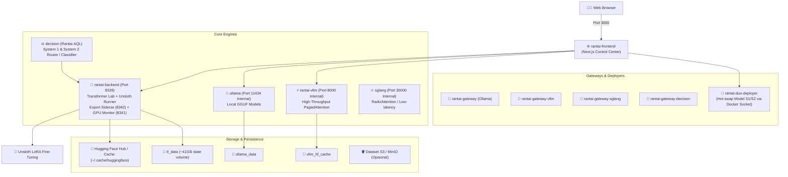

# 🚀 Panduan Lengkap Instalasi RantAI-LLMOps Multi-Container Stack di Box Baru
> **Panduan Replikasi Setup Production (Sesuai Konfigurasi Box UGM / Portainer)**  
> Komponen: **Frontend UI** · **RantAI Backend (Unsloth)** · **vLLM** · **Ollama** · **SGLang** · **Rantai-AQL (Duo System 1 & System 2)** · **API Gateways** · **Hugging Face** · **Dataset/S3**

---

> [!IMPORTANT]
> ### ⚠️ Batasan Environment & Arsitektur (Catatan Resmi Pengembang)
> 1. **Hanya untuk Docker Containerized Environment (Single Node / VM / Bare-metal):**
>    Stack ini **BELUM BISA** dijalankan di cluster berbasis **Pod (Kubernetes / OpenShift / K8s-based Pods)**. Stack bergantung langsung pada Docker Daemon, Docker Network Bridge (`llmops`), shared volumes, IPC host (`ipc: host`), serta socket `/var/run/docker.sock` untuk orkestrasi container.
> 2. **Metode Deployment: Static Pre-provisioning (Bukan Dynamic Spawning):**
>    Idealnya container engine (vLLM, SGLang, dll.) di-spawn secara dinamis saat dibutuhkan (*on-demand*). Namun karena **keterbatasan permission Docker socket & security isolation di Portainer**, mekanisme dynamic spawning belum diterapkan.
>    **Konsekuensi:** Semua container engine (Backend, Ollama, vLLM, SGLang, Gateways, Deployer) **harus dideploy secara statis sekaligus** di awal melalui Docker Compose / Portainer Stack.
> 3. **Strategi Pembagian VRAM GPU:**
>    Karena banyak container GPU yang berjalan bersamaan secara statis, jangan mengalokasikan 100% VRAM ke satu engine saja (misal vLLM di-set `--gpu-memory-utilization 0.90` akan membuat Ollama dan training Unsloth mengalami OOM). Bagilah alokasi VRAM secara bijak (lihat FASE 3 di bawah).

---

## 🏗️ 1. Arsitektur Multi-Container (Microservices)

Berbeda dengan setup standalone, sistem LLMOps yang berjalan di box UGM menggunakan arsitektur **multi-container terpisah** yang terhubung dalam satu Docker network (`llmops`):



---

## 💻 2. Spesifikasi Hardware Minimum Box Baru

* **OS:** Ubuntu 22.04 LTS atau 24.04 LTS (x86_64)
* **GPU:** 1x atau lebih NVIDIA GPU (Ampere/Ada/Hopper/Blackwell: RTX 3090, 4090, A100, H100, L40S, atau DGX Spark)
* **VRAM:** Minimal 16 GB (Direkomendasikan 24 GB+ per GPU)
* **Disk Space:** Minimal **150 GB SSD/NVMe free space** (karena image backend berukuran ~41 GB + bobot model-model LLM)
* **RAM Host:** Minimal 32 GB (Direkomendasikan 64 GB+)

---

## 🛠️ 3. Tahap 1: Setup Host & NVIDIA Container Toolkit (Wajib)

Jalankan perintah ini di terminal host box baru:

```bash
# 1. Update sistem operasi
sudo apt-get update && sudo apt-get upgrade -y
sudo apt-get install -y curl git wget build-essential jq openssl

# 2. Verifikasi Driver NVIDIA (Harus sudah terinstall)
nvidia-smi

# 3. Install Docker Engine resmi
curl -fsSL https://get.docker.com -o get-docker.sh && sh get-docker.sh
sudo usermod -aG docker $USER
newgrp docker

# 4. Install NVIDIA Container Toolkit (Syarat mutlak container bisa baca GPU)
curl -fsSL https://nvidia.github.io/libnvidia-container/gpgkey | sudo gpg --dearmor -o /usr/share/keyrings/nvidia-container-toolkit-keyring.gpg \
  && curl -s -L https://nvidia.github.io/libnvidia-container/stable/deb/nvidia-container-toolkit.list | \
    sed 's#deb https://#deb [signed-by=/usr/share/keyrings/nvidia-container-toolkit-keyring.gpg] https://#g' | \
    sudo tee /etc/apt/sources.list.d/nvidia-container-toolkit.list

sudo apt-get update
sudo apt-get install -y nvidia-container-toolkit
sudo nvidia-ctk runtime configure --runtime=docker
sudo systemctl restart docker

# 5. Uji Coba Akses GPU dari Docker
docker run --rm --gpus all nvidia/cuda:12.4.1-base-ubuntu22.04 nvidia-smi
```

---

## 🔑 4. Tahap 2: Menyiapkan Secrets & Environment Variables

Di box baru, buat direktori kerja:

```bash
mkdir -p ~/rantai-llmops
cd ~/rantai-llmops
```

Generate secret kunci enkripsi yang dibutuhkan:

```bash
# Generate secret untuk JWT TransformerLab & NextAuth
export TL_JWT=$(openssl rand -hex 32)
export TL_REFRESH=$(openssl rand -hex 32)
export AUTH_SEC=$(openssl rand -base64 32)
export DUO_TOKEN=$(openssl rand -hex 24)

# Buat file .env
cat <<EOF > .env
# Security & Auth
TRANSFORMERLAB_JWT_SECRET=${TL_JWT}
TRANSFORMERLAB_REFRESH_SECRET=${TL_REFRESH}
AUTH_SECRET=${AUTH_SEC}
APP_PASSWORD=password_admin_baru
DUO_DEPLOYER_TOKEN=${DUO_TOKEN}

# Model Tokens & Caches
HF_TOKEN=hf_masukkan_token_huggingface_disini
INFERENCE_MODEL=qwen2.5:3b-instruct
CHAT_MAX_TOKENS=8192

# Images (Bisa override jika punya build lokal)
BACKEND_IMAGE=ghcr.io/rantai-dev/rantai-llmops-backend@sha256:d4c323c76cbe7caf4f8c7eecbf9f052ef389bf38bdd104c380563134cd49d4be
FRONTEND_IMAGE=ghcr.io/rantai-dev/rantai-llmops-fe:latest

# Opsional S3/MinIO Dataset
S3_ENDPOINT_URL=
AWS_ACCESS_KEY_ID=
AWS_SECRET_ACCESS_KEY=
AWS_REGION=
EOF
```

---

## 📦 5. Tahap 3: File `docker-compose.yml` Lengkap

Buat file `docker-compose.yml` di folder `~/rantai-llmops/` (sama persis dengan yang ada di Portainer box UGM):

```yaml
version: '3.8'

services:
  # ─── 1. Backend Orchestrator (Transformer Lab + Unsloth Trainer) ───────────
  rantai-backend:
    image: ${BACKEND_IMAGE:-ghcr.io/rantai-dev/rantai-llmops-backend@sha256:d4c323c76cbe7caf4f8c7eecbf9f052ef389bf38bdd104c380563134cd49d4be}
    container_name: rantai-backend
    restart: unless-stopped
    ipc: host
    environment:
      - PYTHONUNBUFFERED=1
      - TRANSFORMERLAB_JWT_SECRET=${TRANSFORMERLAB_JWT_SECRET:?wajib diset}
      - TRANSFORMERLAB_REFRESH_SECRET=${TRANSFORMERLAB_REFRESH_SECRET:?wajib diset}
      - OLLAMA_HOST=http://ollama:11434
      - HF_TOKEN=${HF_TOKEN:-}
    volumes:
      - tl_data:/data
      - ~/.cache/huggingface:/root/.cache/huggingface
    ports:
      - "8339:8339"  # TL API
      - "8341:8341"  # GPU Monitor Sidecar
      - "8342:8342"  # Export / GGUF Runner Sidecar
    deploy:
      resources:
        reservations:
          devices:
            - driver: nvidia
              count: all
              capabilities: [gpu]
    networks:
      - llmops

  # ─── 2. Ollama Container (Local GGUF Models) ────────────────────────────────
  ollama:
    image: ollama/ollama:latest
    container_name: ollama
    restart: unless-stopped
    volumes:
      - ollama_data:/root/.ollama
      - ~/.cache/huggingface:/root/.cache/huggingface
    ports:
      - "11434:11434"
    deploy:
      resources:
        reservations:
          devices:
            - driver: nvidia
              count: all
              capabilities: [gpu]
    networks:
      - llmops

  # ─── 3. vLLM Serving Container (High Throughput / Safetensors) ─────────────
  vllm:
    image: vllm/vllm-openai:latest
    container_name: rantai-vllm
    restart: unless-stopped
    ipc: host
    environment:
      - HF_TOKEN=${HF_TOKEN:-}
    volumes:
      - vllm_hf_cache:/root/.cache/huggingface
    ports:
      - "8000:8000"
    command: >
      --model unsloth/Llama-3.1-8B-Instruct
      --tensor-parallel-size 1
      --gpu-memory-utilization 0.45
      --max-model-len 8192
      --host 0.0.0.0
      --port 8000
    deploy:
      resources:
        reservations:
          devices:
            - driver: nvidia
              count: all
              capabilities: [gpu]
    networks:
      - llmops

  # ─── 4. SGLang Serving Container (RadixAttention / Structured Output) ───────
  # Opsional: Jika VRAM terbatas (<48GB total), jalankan SGLang via profile on-demand:
  # docker compose --profile sglang up -d
  sglang:
    image: lmsysorg/sglang:latest
    container_name: rantai-sglang
    profiles: ["sglang"]
    restart: unless-stopped
    ipc: host
    environment:
      - HF_TOKEN=${HF_TOKEN:-}
    volumes:
      - ~/.cache/huggingface:/root/.cache/huggingface
    ports:
      - "30000:30000"
    command: >
      python3 -m sglang.launch_server
      --model-path unsloth/Llama-3.1-8B-Instruct
      --host 0.0.0.0
      --port 30000
      --mem-fraction-static 0.40
    deploy:
      resources:
        reservations:
          devices:
            - driver: nvidia
              count: all
              capabilities: [gpu]
    networks:
      - llmops

  # ─── 5. Decision Server (Rantai-AQL Router / Classifier) ───────────────────
  decision:
    image: ${DECISION_IMAGE:-rantai-decision-server:latest}
    container_name: rantai-decision
    restart: unless-stopped
    volumes:
      - decision_state:/data
    networks:
      - llmops

  # ─── 6. Duo Deployer (Orchestrator Swap S1/S2 via Docker Socket) ───────────
  duo-deployer:
    image: ${FRONTEND_IMAGE:-ghcr.io/rantai-dev/rantai-llmops-fe:latest}
    container_name: rantai-duo-deployer
    restart: unless-stopped
    command: ["node", "deployer/duo-deployer.cjs"]
    user: "0"
    environment:
      - DUO_DEPLOYER_TOKEN=${DUO_DEPLOYER_TOKEN}
    volumes:
      - /var/run/docker.sock:/var/run/docker.sock
    networks:
      - llmops

  # ─── 7. Frontend Dashboard (RantAI Next.js Control Center) ─────────────────
  frontend:
    image: ${FRONTEND_IMAGE:-ghcr.io/rantai-dev/rantai-llmops-fe:latest}
    container_name: rantai-frontend
    restart: unless-stopped
    ports:
      - "3000:3000"
    environment:
      - INFERENCE_BASE_URL=http://rantai-backend:8339/v1
      - INFERENCE_API_KEY=${INFERENCE_API_KEY:-}
      - OLLAMA_HOST=http://ollama:11434
      - VLLM_BASE_URL=http://vllm:8000/v1
      - SGLANG_BASE_URL=http://sglang:30000/v1
      - GPU_STATS_URL=http://rantai-backend:8341
      - EXPORT_SIDECAR_URL=http://rantai-backend:8342
      - HOST_RUNNER=sidecar
      - INFERENCE_MODEL=${INFERENCE_MODEL:-qwen2.5:3b-instruct}
      - CHAT_MAX_TOKENS=${CHAT_MAX_TOKENS:-8192}
      - DUO_DEPLOYER_URL=http://duo-deployer:8097
      - DUO_DEPLOYER_TOKEN=${DUO_DEPLOYER_TOKEN}
      - APP_PASSWORD=${APP_PASSWORD}
      - AUTH_SECRET=${AUTH_SECRET}
      - HF_TOKEN=${HF_TOKEN:-}
      - S3_ENDPOINT_URL=${S3_ENDPOINT_URL:-}
      - AWS_ACCESS_KEY_ID=${AWS_ACCESS_KEY_ID:-}
      - AWS_SECRET_ACCESS_KEY=${AWS_SECRET_ACCESS_KEY:-}
    volumes:
      - ui_data:/data
    depends_on:
      - rantai-backend
      - ollama
    networks:
      - llmops

volumes:
  tl_data:
  ollama_data:
  vllm_hf_cache:
  decision_state:
  ui_data:

networks:
  llmops:
    driver: bridge
```

---

## 🚀 6. Tahap 4: Menjalankan Stack & Melakukan Bootstrap

### Langkah 1: Jalankan Container Pertama Kali
```bash
docker compose up -d rantai-backend ollama
```
*(Tunggu ~2-3 menit hingga `rantai-backend` selesai inisialisasi volume data).*

### Langkah 2: Bootstrap Auth & Mendapatkan `INFERENCE_API_KEY` (Paling Krusial!)
Aplikasi Transformer Lab di backend baru awalnya belum memiliki API Key. Jalankan script bootstrap berikut untuk men-generate key dan menaikkan quota komputasi:

```bash
# Buat script bootstrap lokal
cat << 'EOF' > bootstrap.sh
#!/bin/bash
set -e
TL_URL="http://localhost:8339"
TL_ADMIN_EMAIL="admin@example.com"
TL_ADMIN_PASSWORD="admin123"

echo "1. Menunggu backend siap di $TL_URL..."
until curl -s -f -o /dev/null "$TL_URL/"; do
  sleep 3
done

echo "2. Login admin..."
TOKEN=$(curl -s -X POST "$TL_URL/auth/jwt/login" \
  -H "Content-Type: application/x-www-form-urlencoded" \
  --data-urlencode "username=$TL_ADMIN_EMAIL" \
  --data-urlencode "password=$TL_ADMIN_PASSWORD" \
  | sed -n 's/.*"access_token":"\([^"]*\)".*/\1/p')

echo "3. Ambil Team ID..."
TEAM_ID=$(curl -s "$TL_URL/users/me/teams" -H "Authorization: Bearer $TOKEN" \
  | sed -n 's/.*"id":"\([^"]*\)".*/\1/p' | head -1)

echo "4. Mint API Key baru..."
API_KEY=$(curl -s -X POST "$TL_URL/auth/api-keys" \
  -H "Authorization: Bearer $TOKEN" -H "Content-Type: application/json" \
  -d "{\"name\":\"rantai-llmops\",\"team_id\":\"$TEAM_ID\"}" \
  | sed -n 's/.*"api_key":"\([^"]*\)".*/\1/p')

echo "5. Naikkan Kuota Komputasi Team..."
curl -s -X PUT "$TL_URL/teams/$TEAM_ID" \
  -H "Authorization: Bearer $TOKEN" -H "Content-Type: application/json" \
  -d '{"compute_quota_minutes": 5000000}' > /dev/null

echo "=========================================="
echo "BERHASIL!"
echo "INFERENCE_API_KEY=$API_KEY"
echo "INFERENCE_TEAM_ID=$TEAM_ID"
echo "=========================================="
echo "INFERENCE_API_KEY=$API_KEY" >> .env
EOF

chmod +x bootstrap.sh
./bootstrap.sh
```

### Langkah 3: Jalankan Seluruh Sisa Stack (Frontend + Engines)
Setelah `.env` terisi `INFERENCE_API_KEY`, jalankan seluruh service:

```bash
docker compose up -d
```

### Langkah 4: Pull Model Default ke Ollama
```bash
docker exec -it ollama ollama pull qwen2.5:3b-instruct
```

---

## 🌐 7. Tahap 5: Akses & Penggunaan Fitur

Buka browser ke IP box baru:
👉 **`http://<IP_BOX_BARU>:3000`**

1. **Login Screen:** Masukkan password `APP_PASSWORD` yang sudah diset di `.env`.
2. **Chat & Playground:** 
   * Bisa memilih engine: **Ollama**, **vLLM**, atau **SGLang**.
   * Model GGUF akan dilayani oleh Ollama.
   * Model safetensors dengan throughput tinggi dilayani oleh vLLM / SGLang.
3. **Training & Fine-Tuning (Unsloth):**
   * Masuk ke tab **Train / Fine-tune**.
   * Pilih base model (misal `unsloth/Llama-3.1-8B-Instruct`).
   * Pilih dataset dari Hugging Face atau S3/upload file.
   * Parameter LoRA (r, alpha, batch size, epochs).
   * Klik **Start Training** -> backend akan menjalankan container Unsloth dengan bubblewrap sandbox.
4. **Export to Use (In-App Pipeline):**
   * Setelah training selesai, klik **Export to use**.
   * Sidecar (`8342`) akan otomatis: **Merge LoRA -> Konversi ke GGUF via llama.cpp -> `ollama create`**.
   * Model langsung muncul di dropdown chat tanpa restart!
5. **Evals & Rantai-AQL Duo:**
   * Tab **Evals** menjalankan evaluasi benchmark (MMLU, GSM8K, dll).
   * Tab **Duo Models** mengatur gating router System 1 (fast classifier) dan System 2 (deep reasoning) via `duo-deployer`.

---

## 🖥️ 8. Cara Deploy via Portainer di Box Baru

Jika temannya ingin memasang via UI Portainer di box baru:

1. Buka Portainer box baru: `https://<IP_BOX_BARU>:9443`
2. Masuk ke menu **Stacks** -> klik **Add stack**.
3. Beri nama stack: `rantai-llmops`.
4. Pilih metode **Web editor** -> Paste seluruh isi `docker-compose.yml` di atas.
5. Pada bagian **Environment variables**, tambahkan variabel berikut:
   * `TRANSFORMERLAB_JWT_SECRET`
   * `TRANSFORMERLAB_REFRESH_SECRET`
   * `AUTH_SECRET`
   * `APP_PASSWORD`
   * `HF_TOKEN`
   * `INFERENCE_API_KEY` (setelah bootstrap dijalankan)
6. Klik **Deploy the stack**.

---

## 🛠️ 9. Troubleshooting Masalah Umum

| Masalah | Penyebab | Solusi |
|---|---|---|
| **Login ke Backend 500 Error** | `TRANSFORMERLAB_JWT_SECRET` belum diset | Pastikan kedua secret JWT diset dan nilainya berbeda di `.env`. |
| **GPU Tidak Terbaca / CUDA Error** | Driver atau Container Toolkit belum terpasang | Jalankan ulang script `nvidia-ctk runtime configure --runtime=docker` dan restart docker daemon. |
| **Training Gagal "Quota Overused"** | Kuota default TransformerLab adalah 0 | Jalankan script `bootstrap.sh` yang menaikkan kuota team menjadi 5000000 menit. |
| **vLLM OOM (Out of Memory)** | KV cache memakan terlalu banyak VRAM | Turunkan `--gpu-memory-utilization` dari `0.85` menjadi `0.70` atau kurangi `--max-model-len`. |
| **Model Chat Tidak Muncul** | Ollama belum pull model default | Jalankan `docker exec -it ollama ollama pull qwen2.5:3b-instruct`. |
| **Hot-swap Duo S1/S2 Gagal** | `duo-deployer` tidak punya akses docker socket | Pastikan volume `/var/run/docker.sock` ter-mount dengan benar di service `duo-deployer`. |
